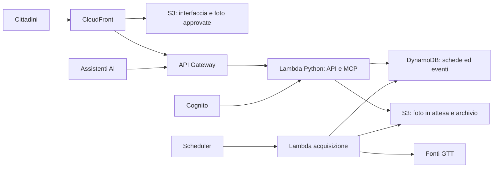

# Scale Mobili Torino — architettura e prova iniziale

Proposta aggiornata il 14 ottobre 2026. **DynamoDB scelto dall'utente**; gli altri componenti restano la proposta iniziale. Stato di partenza del progetto: documentazione e progettazione; codice applicativo e nuova infrastruttura AWS ancora da realizzare. La prova descritta qui è da realizzare; nessun risultato è già misurato.

## Decisione proposta

Adottare una piattaforma AWS con frontend SvelteKit statico, backend Python su Lambda, API HTTP e MCP che condividono la logica applicativa. Usare **DynamoDB Standard**, con capacità provisioned iniziale da dimensionare entro le quote disponibili, e Terraform/GitHub Actions con OIDC per la distribuzione. La prova convalida chiavi, indici, concorrenza e consumo di DynamoDB.

La regione proposta torna a **eu-south-1, Milano**, coerente con il progetto precedente: DynamoDB è disponibile anche lì. Verificare l'accesso alla regione nell'account prima del bootstrap. Tenere backend, database e storage regionali nella stessa regione. CloudFront resta il punto di distribuzione globale. [Disponibilità regionale DynamoDB](https://docs.aws.amazon.com/general/latest/gr/ddb.html).

Il budget richiesto resta **0 euro**. Questa architettura punta a un consumo minimo, ma non garantisce una fattura nulla. La decisione economica precede l'attivazione della prova: verificare le quote effettivamente disponibili nell'account e presentare una stima delle voci residue. Il presente documento non autorizza una spesa di un dollaro né un abbonamento.

## Componenti e responsabilità

| Parte | Scelta proposta | Responsabilità |
| --- | --- | --- |
| Interfaccia | SvelteKit + TypeScript, build statica | Elenco stazioni, schede impianti, storico, segnalazione e moderazione |
| Distribuzione web | S3 privato + CloudFront | HTML, asset e immagini approvate; accesso S3 tramite Origin Access Control |
| API | API Gateway HTTP API + Lambda Python | Letture pubbliche, scritture autenticate, validazione e limiti |
| Logica applicativa | Moduli Python condivisi | Identità impianti, osservazioni, rettifiche, confronto fonti e statistiche |
| MCP | SDK Python ufficiale, endpoint HTTP stateless | Strumenti che chiamano gli stessi servizi dell'API |
| Database | DynamoDB Standard, due tabelle con chiavi composte | Censimento/schede correnti e storico degli eventi |
| Identità | Cognito Essentials, senza componenti aggiuntivi nella prova | Accesso cittadini, gruppi moderatori, OAuth con PKCE |
| Foto in attesa | S3 privato + Lambda di elaborazione | Controllo file, ricodifica senza EXIF, revisione manuale |
| Archivio fonti | S3 privato + metadati DynamoDB | Originali, hash del contenuto e registro di ogni acquisizione |
| Acquisizione | EventBridge Scheduler + Lambda dedicata | Recupero delle fonti e registrazione di successi/errori |
| Distribuzione | Terraform + GitHub Actions OIDC | Infrastruttura ripetibile e credenziali temporanee |
| Operazioni iniziali | AWS CloudShell | Configurazione amministrativa iniziale nell'account personale |

La build statica di SvelteKit consente di distribuire l'interfaccia come file. Le operazioni dinamiche risiedono nell'API Python. [Documentazione SvelteKit](https://svelte.dev/docs/kit/adapter-static).

Il diagramma rappresenta i collegamenti logici. I token sono emessi da Cognito al client e verificati dal backend; Cognito non richiama il backend per ogni richiesta. L'upload fotografico passa da un'autorizzazione dell'API e poi raggiunge direttamente lo spazio privato S3 con un permesso temporaneo.

Per la prova bastano una Lambda per API/MCP, una per le fotografie e una per l'acquisizione. La suddivisione protegge le richieste del sito da elaborazioni lente e permette permessi differenti. Il progetto precedente fornisce il metodo di bootstrap e deploy; AgentCore non è un componente previsto in questa proposta.

## DynamoDB: flessibilità dei documenti e progetto degli accessi

DynamoDB è la scelta confermata. Usare Python e `boto3`, con permessi IAM limitati alle tabelle e alle operazioni necessarie. Gli attributi dei documenti possono evolvere; chiavi e accessi richiedono invece una progettazione esplicita e migrazioni quando cambiano.

Proposta iniziale: tabella `core` per censimento, stato corrente, metadati foto, moderazione e risultati precalcolati; tabella `events` per segnalazioni, conferme, rettifiche e acquisizioni. Entrambe usano `PK` e `SK` di tipo stringa. IDs immutabili determinano le chiavi principali; nome della stazione, stato e gestore restano attributi modificabili.

Tre GSI iniziali: `core.by_station` per gli impianti confermati di una stazione, `core.review_queue` per proposte, foto e interpretazioni in attesa di revisione, `events.by_actor` per i contributi di un utente. Proiezioni limitate agli attributi necessari; nessun LSI nella prima versione. Gli indici GSI possono essere aggiunti in seguito, mentre gli LSI vanno definiti alla creazione della tabella. [Indici DynamoDB](https://docs.aws.amazon.com/amazondynamodb/latest/developerguide/SecondaryIndexes.html).

Le risposte subito dopo una scrittura e le decisioni di moderazione verificano i record nelle tabelle base; le liste ottenute dai GSI tollerano un aggiornamento asincrono. Le scritture usano condizioni e transazioni per impedire duplicati e conflitti. Le statistiche sono proiezioni ricalcolabili con metodo e copertura dichiarati.

I dettagli delle chiavi, degli accessi, degli indici e della loro evoluzione sono nel [modello DynamoDB](modello-dynamodb.md). La prova deve dimostrare che le funzioni del sito usano accessi mirati e paginati, senza Scan dello storico nel percorso di una richiesta pubblica.

## Modello dei dati e significato degli stati

| Entità | Contenuto essenziale |
| --- | --- |
| Stazione | ID interno, nome verificato, eventuali coordinate e fonte |
| Impianto | ID stabile, stazione, posizione, percorso servito, gestore, stato della verifica del censimento |
| Proposta di impianto | Descrizione, autore, evidenze, possibili duplicati, decisione del moderatore |
| Segnalazione | Impianto, stato osservato, autore interno, momento osservato e momento registrato |
| Conferma/rettifica | Riferimento alla segnalazione, autore, timestamp e motivazione |
| Fotografia | Impianto, oggetto privato/approvato, hash, esito elaborazione e moderazione |
| Contenuto ufficiale | URL, hash, oggetto archiviato, eventuale data di pubblicazione |
| Acquisizione | Fonte, momento, esito, riferimento al contenuto o errore |
| Interpretazione ufficiale | Contenuto sorgente, impianto associato, stato estratto, revisore, versione |
| Elaborazione | Metodo/versione, periodo, copertura e riferimenti alle evidenze |

Gli ID interni sono assegnati dal progetto; gli ID GTT compaiono solo con evidenza verificata. Proposte non confermate e dati di prova restano chiaramente distinguibili dagli impianti censiti. L'assenza di un gestore noto resta un dato mancante.

I quattro stati segnalabili sono `funzionante`, `guasta`, `manutenzione`, `non_verificabile`. **Nessuna informazione disponibile** è invece assenza di evidenze: non equivale a un'osservazione di stato non verificabile.

Ogni risposta presenta separatamente informazioni ufficiali, community e stima, con fonte, timestamp e freschezza. La prima versione può mostrare il numero di osservazioni e di account distinti senza attribuire una percentuale di attendibilità. Account distinti non dimostrano, da soli, osservazioni indipendenti.

Le rettifiche sono nuovi eventi collegati all'originale. Lo storico pubblico può escludere contenuti rimossi dalla moderazione, conservando la traccia della rettifica; la cancellazione dei dati personali deve poter essere gestita separatamente. Le email e i token non entrano nello storico pubblico.

Tempi distinti: osservazione, pubblicazione quando nota, acquisizione e registrazione. Salvare istanti in UTC e mostrarli con il fuso Europe/Rome. Inizio e fine effettivi di un'interruzione restano sconosciuti quando non documentati.

Le statistiche restituiscono dati non disponibili e una motivazione se la copertura è insufficiente. Si possono pubblicare conteggi di segnalazioni etichettati come tali; non trasformarli in numero di guasti o disponibilità temporale. Il censimento verificato, gli intervalli osservati e i criteri di copertura determinano i denominatori.

## API, MCP e autenticazione

Usare un backend Python con FastAPI per l'API e l'SDK MCP ufficiale per il protocollo. L'adattatore per Lambda, il ciclo di vita del server MCP e le versioni delle dipendenze sono elementi da verificare nella prova. Fissare versioni stabili compatibili con i client; evitare dipendenze dal ramo di sviluppo degli SDK.

Per i primi strumenti usare richieste brevi e risposte JSON su trasporto Streamable HTTP stateless. Verificare anche handshake, notifiche e metodi previsti dalla versione del protocollo scelta. Una chiamata JSON riuscita con un client di test non basta a dichiarare compatibilità con ChatGPT.

Le letture pubbliche mostrano solo evidenze pubblicabili. Le scritture richiedono un utente autenticato, scope applicativo, autorizzazione sull'operazione e limiti antiabuso. L'API attribuisce l'autore dal token: il client non può scegliere un altro autore. Le operazioni di moderazione verificano il ruolo sul server.

MCP iniziale: `list_stations`, `list_escalators`, `get_escalator_status`, `get_station_status`, `get_escalator_history`, `get_outage_statistics`, `compare_official_reports`, `submit_escalator_report`. Implementazione progressiva; nella prova bastano stato, storico e invio segnalazione. Le risposte includono link consultabili alle schede/fonti e le incertezze. Una descrizione ambigua richiede di identificare l'impianto prima della scrittura.

Per ChatGPT sono necessari OAuth, PKCE S256, metadati della risorsa protetta e verifica di issuer, audience, scadenza e scope. La documentazione ammette client OAuth predefiniti: è il percorso proposto per la prima connessione, con callback ottenuta dal client reale. La prova deve verificare anche rinnovo e vincolo del token alla risorsa. [OpenAI Docs: autenticazione MCP](https://developers.openai.com/plugins/build/auth).

Cognito documenta il parametro `resource` per attribuire l'audience ai token. Verificare la combinazione reale con MCP e client, senza indebolire i controlli se la connessione fallisce. [Resource binding Cognito](https://docs.aws.amazon.com/cognito/latest/developerguide/cognito-user-pools-define-resource-servers.html).

Letture e scritture possono essere esposte con autenticazione mista, da provare nel client. La prova in ChatGPT non certifica Gemini: verificare separatamente CLI e app, disponibilità dell'account e rinnovo. Il backend non richiede un servizio di inferenza AI a pagamento.

## Fotografie e fonti ufficiali

Le fotografie sono caricate in uno spazio privato tramite autorizzazioni temporanee limitate a un singolo oggetto. Verificare tipo reale, dimensioni del file e numero di pixel. Valori iniziali proposti: JPEG, PNG o WebP, massimo 5 MB e 20 megapixel. Ricodificare l'immagine, eliminare EXIF e produrre una versione di visualizzazione ridotta. Rimuovere l'originale non sanitizzato dopo l'elaborazione riuscita.

La foto sanitizzata resta privata fino alla revisione dell'impianto associato e del contenuto. Solo un moderatore può pubblicarla e scegliere la principale. Hash per duplicati identici; somiglianza visiva e duplicati parziali restano una funzione successiva. Segnalazione e rimozione di foto errate fanno parte della prima versione pubblica.

Per GTT, salvare i byte originali una sola volta per hash e registrare ogni acquisizione, anche quando il contenuto è uguale o il tentativo fallisce. Conservare URL, risposta HTTP pertinente, momento di acquisizione e versione dell'estrazione. Un errore di acquisizione non modifica lo stato degli impianti. Eventuali associazioni incerte restano in revisione.

La pagina ufficiale specifica che il report riguarda manutenzioni straordinarie; l'assenza di un impianto non dimostra funzionamento. Distingue inoltre le competenze a Porta Susa e Porta Nuova. Questi limiti devono accompagnare le interpretazioni. [Pagina ufficiale GTT](https://www.gtt.to.it/cms/en/19-linee-e-orari/urbana/12186-metropolitana-aggiornamento-ascensori-e-scale-mobili).

Frequenza iniziale proposta: una rilevazione ogni quattro ore, da attivare dopo la verifica delle condizioni della fonte. Nella prova effettuare acquisizioni controllate e usare risposte di test per errori e duplicati. L'estrazione dalle immagini parte con revisione manuale. Le copie archiviate restano private finché non sono verificate le condizioni per la loro pubblicazione; metadati e riferimenti possono rendere consultabile la provenienza.

## Sviluppo cloud e costi

Riprendere da `mcp-serverless-kit` il percorso CloudShell → bootstrap → ruolo OIDC → Terraform → GitHub Actions. Il workflow verificato è manuale e limitato a `main`, con stato privato su S3. Nel nuovo progetto usare nomi, ruoli, stato e risorse dedicati; un provider OIDC account-wide esistente va ispezionato e riutilizzato quando appropriato. [Workflow precedente](https://github.com/giulionenna/mcp-serverless-kit/blob/main/.github/workflows/deploy.yml).

I test delle contribuzioni non ricevono credenziali AWS. Il deploy parte dal ramo autorizzato e applica un piano sul commit verificato. Stato Terraform e piani restano privati; il riepilogo pubblico contiene solo esiti e identificativi non sensibili. Gli strumenti vengono installati nei runner cloud: l'utente non deve mantenere un ambiente sul PC.

| Voce | Evidenza attuale e verifica richiesta |
| --- | --- |
| DynamoDB | Standard/provisioned: 25 GB, 25 RCU e 25 WCU gratuiti; conteggiare insieme tabelle e GSI e verificare quota già usata |
| CloudFront | Candidato piano Free a 0 USD/mese; verificare idoneità dell'account e inclusioni |
| Cognito | Essentials/Lite: 10.000 MAU gratuiti per accessi diretti/social; verificare pool e uso già presente |
| HTTP API | Consumo a richiesta; la quota gratuita pubblicata è temporanea per nuovi clienti |
| S3 | Richieste, storage, versioni, foto e backup; i crediti storage non coprono ogni operazione |
| Altre voci | Lambda, Scheduler, log ed eventuali email; includere tutto nella stima |

Fonti: [DynamoDB prezzi](https://aws.amazon.com/dynamodb/pricing/), [CloudFront piani](https://docs.aws.amazon.com/AmazonCloudFront/latest/DeveloperGuide/flat-rate-pricing-plan.html), [Cognito prezzi](https://aws.amazon.com/cognito/pricing/), [HTTP API prezzi](https://aws.amazon.com/api-gateway/pricing/).

La capacità provisioned viene allocata e fatturata per tempo, anche senza richieste; entro la quota disponibile può essere gratuita. La quota non si moltiplica creando nuove tabelle o indici. Dimensionare e misurare ciascuna risorsa, incluse le scritture sugli indici e le transazioni. Un indice sottodimensionato può rallentare anche le scritture sulla tabella. [Capacità dei GSI](https://docs.aws.amazon.com/amazondynamodb/latest/developerguide/GSI.html).

Il piano CloudFront Free include una quota di traffico e crediti S3 Standard; non include il consumo applicativo di API, Lambda o database. La sua disponibilità dipende anche dal tipo di account. Verificare gestione ripetibile della sottoscrizione insieme all'infrastruttura prima di includerla nel deploy.

Per contenere il consumo: cache breve sulle letture pubbliche, nessuna cache condivisa sulle richieste autenticate o MCP, paginazione e limiti alle query, upload limitati, log essenziali con conservazione breve, aggregazioni periodiche. Mostrare il timestamp dei dati anche quando arrivano dalla cache. Configurare limiti applicativi e avvisi; gli avvisi non sono un tetto di spesa.

Nella prova usare export privati versionati e verificare un ripristino. Prima della pubblicazione definire backup regolari, retention e recupero sia del database sia dei file. Versionamento S3 e replica del database non sostituiscono una prova di ripristino.

## Prova tecnica da realizzare

La prova deve rispondere a quattro domande: chiavi e indici DynamoDB coprono gli accessi previsti, il percorso fotografico mantiene la moderazione, MCP funziona nel client reale e il consumo è compatibile con il budget?

Usare **una stazione e due impianti interamente fittizi**, marcati come dati di prova, due utenti di test e un moderatore. Nessun dato sintetico va presentato come censimento di Torino. Le risorse della prova hanno un'identità dedicata e un inventario per la successiva rimozione.

| Verifica | Operazione | Criterio di riuscita |
| --- | --- | --- |
| 1. Deploy cloud | Bootstrap, distribuzione e smoke check | Workflow riuscito, endpoint raggiungibili, nessuna chiave permanente |
| 2. Segnalazione | Login, invio, lettura e rettifica | Storico persistente, autore dal token, originale e rettifica collegati |
| 3. DynamoDB | Query per stazione/impianto/periodo, paginazione, transazioni e ritentativi | Nessuna perdita o duplicazione; GSI asincroni gestiti; nessuna Scan dello storico nelle richieste pubbliche |
| 4. Foto | Upload valido, file errato, revisione e approvazione | File errato respinto; foto non approvata inaccessibile; versione pubblica senza EXIF |
| 5. Archivio GTT | Due contenuti uguali, uno diverso e un errore simulato | Quattro tentativi registrati, due originali distinti, errore separato dagli stati |
| 6. MCP lettura | Scoperta strumenti e chiamata di stato/storico | Risultato coerente con l'API, fonte e timestamp presenti |
| 7. MCP scrittura | Login OAuth, invio nel client reale e rinnovo | Una segnalazione registrata con identità corretta; rinnovo funzionante |
| 8. Autorizzazione | Token assente, scaduto, audience/scope errati; utente non moderatore | Scritture e moderazione respinte nei casi non autorizzati |
| 9. Dati incerti | Fonte assente, conflitto, storico incompleto, impianto ambiguo | Nessuno stato inventato, nessuna percentuale ingiustificata, nessuna scrittura ambigua |
| 10. Recupero | Export e ripristino dei dati di prova | Segnalazioni, rettifiche e riferimenti ai file recuperabili |
| 11. Consumo | Lotto piccolo, richieste a caldo/freddo e capacità allocata | Tempi, errori, capacità di tabelle/GSI, throttling, durata Lambda e byte archiviati misurati |

Per la parte funzionale limitare il lotto a circa 100 letture, 10 segnalazioni e 3 foto di prova. Provare i ritentativi entro questo lotto. Un piccolo campione serve a identificare incompatibilità e ordini di grandezza, non certifica la capacità su traffico reale.

Registrare latenza mediana e 95° percentile, distinguendo invocazioni a caldo e avvio a freddo; usare 5 secondi come obiettivo iniziale da valutare, non come prestazione promessa. Riportare i timeout separatamente. Rilevare capacità consumata per tabella/indice, capacità allocata, byte degli indici e throttling. Le risorse provisioned continuano a occupare quota anche quando il traffico è nullo.

La stima mensile parte da un'ipotesi dichiarata: 10.000 richieste dinamiche, 100 segnalazioni, 100 nuove foto compresse, sei acquisizioni giornaliere e dimensione corrente dell'archivio. È uno scenario di calcolo, non una previsione di traffico. Applicare le tariffe di Milano e distinguere costo lordo, quote effettivamente residue e consumo di servizi già presenti nell'account.

Il rapporto finale della prova deve riportare commit e versioni, regione, operazioni riuscite, incompatibilità, tempi e consumo; per ogni client distinguere discovery, lettura, scrittura e rinnovo. Se i dati di fatturazione non sono ancora disponibili, presentarli come pendenti, senza dichiarare costo zero.

**Decisione dopo la prova:** convalidare il modello DynamoDB e il percorso MCP sulle verifiche riuscite; correggere chiavi, indici o componenti falliti prima del censimento reale. Se emergono costi incompatibili con il budget zero, presentare le voci concrete prima di procedere. Disattivare i processi della prova e predisporre la rimozione delle sole risorse dedicate dopo aver salvato i risultati.

## Confini della prima versione pubblica

Prima release: censimento progressivo con proposte moderate, stati per singolo impianto e fonti separate, segnalazioni autenticate con conferme/rettifiche, fotografie moderate, archivio GTT verificabile, storico, API e MCP. Pubblicare soltanto statistiche sostenute dai dati e una descrizione esplicita della copertura.

Funzioni successive: estrazione automatica verificata dalle immagini, indicatore di attendibilità con metodo valutato, statistiche sulle interruzioni con copertura sufficiente e rilevamento fotografico per somiglianza. Queste restano requisiti del progetto; la prova iniziale non equivale alla loro realizzazione.

Nome pubblico, dominio e licenze di codice, dati e fotografie restano da scegliere prima della pubblicazione. Per la prova usare gli indirizzi forniti dai servizi. L'accesso amministrativo AWS, la verifica delle quote e la disponibilità dei client nell'account restano da controllare nel passaggio di attivazione.
